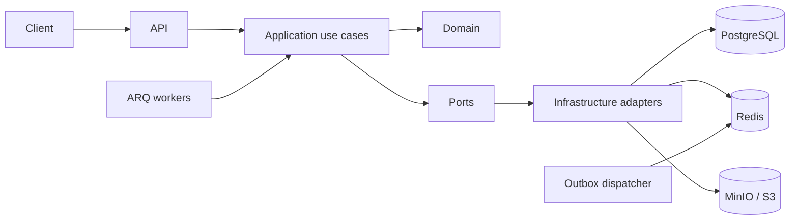

# RAG Platform

Multi-tenant retrieval-augmented generation service: ingest documents, index chunks with embeddings, run hybrid search, and answer questions with cited context. Evaluations and operational hooks (health, metrics, rate limits) are built in for local development and staged production rollout.

## Features

Implemented today:

- **Document upload** — multipart upload to object storage; metadata scoped by organization and knowledge base.
- **Parsing** — plain text and PDF extraction behind a parser registry.
- **Chunking and indexing** — normalization, fixed-size chunking, embedding, and persistence (background job).
- **Embeddings** — provider abstraction; deterministic fake vectors for tests, local `bge-m3` (1024 dims) through `sentence-transformers`.
- **Vector and full-text retrieval** — pgvector similarity plus PostgreSQL full-text search.
- **Hybrid retrieval** — score fusion, optional `bge-reranker-v2-m3` cross-encoder, relevance threshold that refuses without calling the LLM.
- **RAG chat** — context assembly, LLM call, citation validation with page numbers for PDFs, concurrency and budget guards (Redis).
- **Query history** — stored queries with retrieval/LLM metadata; fetch by id.
- **Fact extraction** — `POST /v1/extract` returns parties, dates, amounts, obligations, risks, decisions and owners with quote citations and a `missing` list.
- **Evaluations** — async eval runs over datasets with lease-based worker safety.
- **Tenant isolation** — organization- and knowledge-base-scoped data; per-organization API keys.
- **Background processing** — ARQ workers on Redis; transactional outbox for reliable side effects.

## Architecture overview

The codebase follows a **Hexagonal Lite** layout under `src/rag_platform/`:

| Layer | Role |
|-------|------|
| **Domain** | Entities, enums, errors, tenant context. |
| **Application** | Use cases, ports, validation, retrieval and prompt assembly. |
| **Infrastructure** | SQLAlchemy repos, S3, Redis, provider adapters, outbox, guards. |
| **API** | FastAPI transport — auth deps, rate limit, routers, schemas. |
| **Workers** | ARQ task functions, outbox dispatcher cron, stale recovery. |
| **Composition** | `composition/http.py` and `composition/worker.py` wire adapters to use cases. |



Deeper diagrams and boundaries: [docs/architecture.md](docs/architecture.md).

## Tech stack

- **Runtime:** Python 3.13+, [uv](https://docs.astral.sh/uv/)
- **API:** FastAPI, Uvicorn
- **Data:** PostgreSQL 16 + pgvector, SQLAlchemy 2 (async), Alembic
- **Queue / cache:** Redis, [ARQ](https://arq-docs.helpmanual.io/)
- **Object storage:** S3-compatible (LocalStack in Compose)
- **Quality:** Ruff, pytest (see [Makefile](Makefile) and CI)

## Quick start

Prerequisites: Docker, Docker Compose, [uv](https://docs.astral.sh/uv/).

```bash
git clone <repository-url>
cd rag-platform

cp .env.example .env
# edit .env if you change ports or secrets (see Configuration)

make install
make compose-up
make migrate
```

Migration `0003_dev_seed_org_kb` seeds organization `00000000-0000-0000-0000-000000000001` and a default knowledge base for local testing.

Migration `0011_embedding_dimension_1024` moves chunk vectors to 1024 dimensions for `bge-m3` and drops old chunks. Re-index documents after upgrading if you used a smaller embedding model.

Check the stack:

```bash
curl -sS http://localhost:8000/health
curl -sS http://localhost:8000/ready
```

Interactive API docs: `http://localhost:8000/docs` (with the API running).

Host-only API (dependencies in Compose):

```bash
docker compose up -d postgres redis s3
make migrate
uvicorn rag_platform.main:app --host 0.0.0.0 --port 8000 --reload
```

Workers (Redis and DB must be up):

```bash
arq rag_platform.workers.settings.WorkerSettings
```

The Compose `worker` service runs the same ARQ settings class as the [Dockerfile](Dockerfile).

## Demo

```bash
docker compose up -d postgres redis s3
make migrate
make demo
```

`make demo` ingests three example documents and asks three questions. With real providers the output looks like this:

```text
Q: What does express delivery cost and how fast is it?
A: Express delivery costs an extra 15 EUR and arrives within 24 hours in selected cities [a1bcd29b-...].
   citations: 1
```

HTTP examples for upload, chat and evaluation live in [examples/http/api.http](examples/http/api.http).

## Evaluation

The repository ships a synthetic corpus of 12 documents (`examples/corpus`) and 44 questions (`evals/dataset.json`): 39 answerable, including multi-document ones, and 5 that the corpus cannot answer.

```bash
# fake providers: checks the pipeline, not the quality
make eval

# real providers: needs Postgres, Redis, `uv sync --extra local` and an LLM key
EMBEDDINGS_PROVIDER=bge_m3 RERANKER_PROVIDER=bge_reranker \
LLM_PROVIDER=openai LLM_API_KEY=... make eval
```

Each run ingests the corpus into a fresh knowledge base, asks every question through the chat pipeline and writes `reports/eval-YYYY-MM-DD.md`.

| Date | Providers | hit@5 | answers with citations | answer fact match | refusal correctness | p50 | p95 | tokens | cost |
|------|-----------|-------|------------------------|-------------------|---------------------|-----|-----|--------|------|
| 2026-11-10 | bge-m3, bge-reranker-v2-m3, deepseek-chat | 1.000 | 1.000 | 1.000 | 1.000 | 4.39 s | 5.30 s | 21,253 in / 533 out | $0.0436 |

The corpus is small and synthetic, so these numbers show that the pipeline works end to end, not that the system generalises. Add your own documents under a new corpus directory to measure a realistic case.

### Retrieval ablation

`make eval-matrix` ingests the corpus plus 16 distractor documents and runs 18 answerable questions in eight retrieval configurations. No LLM calls: this measures retrieval only.

| Embeddings | Retrieval | Reranker | hit@1 | hit@5 | MRR@5 | p50, ms |
|------------|-----------|----------|-------|-------|-------|---------|
| fake | vector | off | 0.111 | 0.111 | 0.139 | 3.3 |
| fake | vector | bge-reranker | 0.944 | 1.000 | 0.972 | 2762 |
| fake | hybrid | off | 0.111 | 0.111 | 0.139 | 4.9 |
| fake | hybrid | bge-reranker | 0.944 | 1.000 | 0.972 | 2753 |
| bge-m3 | vector | off | 0.944 | 1.000 | 0.972 | 78 |
| bge-m3 | vector | bge-reranker | 0.944 | 1.000 | 0.972 | 2781 |
| bge-m3 | hybrid | off | 0.944 | 1.000 | 0.972 | 56 |
| bge-m3 | hybrid | bge-reranker | 0.944 | 1.000 | 0.972 | 2874 |

What the table says:

- Embedding quality dominates. Deterministic fake vectors score 0.111 hit@5, bge-m3 scores 1.000 on the same questions.
- On this corpus hybrid retrieval does not beat vector-only once bge-m3 is used: hit@1 and MRR are identical. Keep the full-text branch for rare tokens and exact identifiers, but do not expect a gain on policy questions.
- The reranker adds roughly 2.7 seconds per question and changes nothing here. It only rescues the fake embeddings, which is a synthetic artefact, not a reason to enable it in production. Measure reranking on your own corpus before paying that latency.
- The corpus is small and synthetic, so treat the numbers as a reproducible harness, not as a universal benchmark.

## Fact extraction

`POST /v1/extract` turns an indexed document into JSON with quote-level citations:

```bash
curl -sS -X POST http://localhost:8000/v1/extract \
  -H 'Content-Type: application/json' -H 'X-Organization-Id: 00000000-0000-4000-8000-000000000001' \
  -d '{"knowledge_base_id": "...", "document_id": "..."}'
```

Each fact carries `text`, `quote`, and a citation with `chunk_id`, `chunk_index` and `page` when the parser knows it. Fields the document does not mention arrive in `missing`. The endpoint needs a real LLM (`LLM_PROVIDER=openai` plus `LLM_API_KEY`); with fake providers it returns `503`. Documents longer than 24,000 characters are truncated, and the response sets `truncated`.

## Configuration

Variables are read from `.env` (template: [.env.example](.env.example)). Defaults align with [docker-compose.yml](docker-compose.yml):

| Service | Host port |
|---------|-----------|
| API | 8000 |
| PostgreSQL | 5436 |
| Redis | 6380 |
| S3 (LocalStack) | 4566 |

Exhaustive list and production rules: [docs/configuration.md](docs/configuration.md).

## Running the application

| Task | Command |
|------|---------|
| Install deps | `make install` |
| Lint | `make lint` |
| Tests | `make test` |
| Full stack | `make compose-up` |
| Validate Compose | `make compose-config` |
| Migrations | `make migrate` |

Compose services: `postgres`, `redis`, `s3`, `s3-init`, `migrate`, `api`, `worker`. The app services live behind the `app` profile.

## API and authentication

**Prefix:** `/v1`

| Method | Path | Notes |
|--------|------|--------|
| `GET` | `/health`, `/ready` | Public |
| `GET` | `/metrics` | Prometheus |
| `GET` | `/v1/documents` | List |
| `POST` | `/v1/documents` | Upload (202) |
| `GET` | `/v1/documents/{document_id}` | Metadata |
| `DELETE` | `/v1/documents/{document_id}` | Delete |
| `POST` | `/v1/chat` | RAG chat |
| `GET` | `/v1/queries/{query_id}` | Query record |
| `POST` | `/v1/evaluations` | Start (202) |
| `GET` | `/v1/evaluations/{evaluation_id}` | Status |

Details: [docs/api.md](docs/api.md).

### Tenant API keys

With `ALLOW_OPEN_API=false` (`.env.example` default), use:

```http
Authorization: Bearer <secret>
```

Keys are scoped to an organization; only a hash is stored server-side. The plaintext secret is printed **once** on create.

```bash
uv run python -m rag_platform.cli.manage_api_keys create \
  --organization-id 00000000-0000-0000-0000-000000000001 \
  --name local-dev

uv run python -m rag_platform.cli.manage_api_keys list \
  --organization-id 00000000-0000-0000-0000-000000000001

uv run python -m rag_platform.cli.manage_api_keys revoke --key-id <uuid>
```

`ALLOW_OPEN_API=true` bypasses tenant resolution for local experiments only. Production enforces `API_KEY_HASH_PEPPER` and rejects fake providers (`config/settings.py`).

Example:

```bash
curl -sS -H "Authorization: Bearer <your-key>" \
  http://localhost:8000/v1/documents
```

## Background workers

ARQ consumes `ARQ_REDIS_URL` (Compose: Redis logical DB `1`; cache/rate limit use DB `0`).

Jobs in `WorkerSettings.functions`:

- `process_document_job` — parse, chunk, embed, index.
- `requeue_stale_documents_job` — document recovery.
- `recover_stale_evaluations_job` — evaluation lease recovery.
- `dispatch_outbox_events_job` — transactional outbox polling.

Processing is **at-least-once** (retries on workers and outbox). Design handlers for idempotency where needed.

## Documentation

| Document | Contents |
|----------|----------|
| [docs/api.md](docs/api.md) | HTTP contract |
| [docs/architecture.md](docs/architecture.md) | Structure and flows |
| [docs/configuration.md](docs/configuration.md) | Environment |

Team ADRs: `.cursor/docs/decisions/` (not in this git tree).

## Current limitations

- **Providers:** Dev defaults use fake LLM, reranker, and embeddings so tests stay deterministic. Real mode uses `bge-m3` embeddings, `bge-reranker-v2-m3`, and any OpenAI-compatible chat endpoint; only that shape is supported, not a multi-vendor matrix.
- **Cost:** Redis chat guards use **estimates**; no billing system.
- **Semantics:** ARQ + outbox = **at-least-once**, not exactly-once.
- **Operations:** Integration tests and `scripts/load_test_chat.py` help, but production still needs your own load and failure testing.
- **Auth:** API keys per organization only — no bundled IdP/OAuth flow.

CI: `make lint`, `make test`, [.github/workflows/ci.yml](.github/workflows/ci.yml).

## License

MIT. See [LICENSE](LICENSE).
